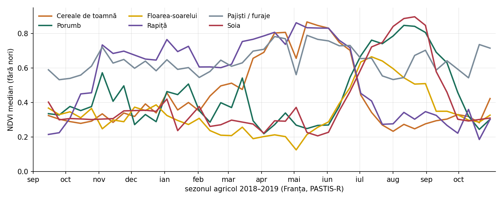

# Data Card — A7: AgriTwin · PASTIS-R → RO, segmentare parcele cu puține etichete

**Autor:** David Gradea · **Checkpoint:** CP1 · **Strat:** Observații · **Repo:** github.com/davidgradea/ic3

**Întrebarea:** Cât din acuratețea unui model de segmentare a culturilor antrenat pe Franța (PASTIS-R) se păstrează pe parcele românești când am doar câteva zeci de parcele etichetate local?

**Client → decizie:** APIA (inspectorul de control) → ce parcele selectează pentru verificare pe teren: cele unde cultura detectată nu se potrivește cu declarația fermierului.

---

## 1. Sursele de date

| Câmp | PASTIS-R (sursă, Franța) | Sentinel-2 România (țintă) | DACIA5 (validare externă, opțional) |
|---|---|---|---|
| **Rol** | antrenare, validare, test în domeniul sursă | aplicare / test pe RO; fine-tuning pe k parcele | test extern pe RO cu etichete verificate pe teren |
| **Sursă** | Zenodo, DOI 10.5281/zenodo.5735646 (PASTIS-R.zip, 53,7 GB); cod: github.com/VSainteuf/pastis-benchmark | Google Earth Engine: `COPERNICUS/S2_SR_HARMONIZED` + `GOOGLE/CLOUD_SCORE_PLUS/V1/S2_HARMONIZED`; opțional `COPERNICUS/S1_GRD` | Zenodo, DOI 10.5281/zenodo.14915950 |
| **Perioadă** | S2: 17.09.2018 – 27.10.2019; S1 pe aceeași fereastră | sezon agricol 01.09.2023 – 31.10.2024 (anul recoltei 2024) | 2020 – 2024 |
| **Zonă** | 4 tile-uri S2 în Franța metropolitană (t30uxv, t31tfj, t31tfm, t32ulu), ~4.000 km² | pătrat 10 × 10 km centrat la 26,0° E, 44,6° N (sud de București), `zona_ro.geojson` | nord de Brașov |
| **Rezoluție spațială** | 10 m; patch-uri 128 × 128 px (1,28 km) | 10 m (benzile de 20 m reeșantionate) | 10 m; patch-uri 32 × 32 px |
| **Rezoluție temporală** | S2: 38–61 date / patch (neregulat, ~5 zile minus nori); S1A: 65–71 date; S1D: 69–70 date | revizitare S2 ~5 zile; număr efectiv de date utile în `RO_2024/s2_inventory.csv` | 172 imagini S2, 159 imagini S1 în 5 ani |
| **Unități** | S2: reflectanță ×10⁴, int16, 10 benzi (B2, B3, B4, B5, B6, B7, B8, B8A, B11, B12); S1: dB, float16, 3 canale (VV, VH, VV/VH); etichetă: uint8 0–19 | S2: reflectanță ×10⁴, aceleași 10 benzi, aceeași ordine; Cloud Score+: `cs_cdf` 0–1 | S2: 12 benzi; S1: 2 benzi |
| **Eșantioane** | 2.433 patch-uri; 124.422 parcele (oficial); 18 culturi + fundal + void | 1 zonă; parcele etichetate manual: 30–50 (în lucru) | 6.454 patch-uri S2, 5.995 patch-uri S1 |
| **Etichete** | LPIS francez 2019 (declarații fermieri), semantice + pe instanță | manuale, de autor, după protocol scris (doar parcele cu cultură clară) | in situ, verificate pe teren |
| **Licență** | CC BY 4.0 | date Copernicus: utilizare liberă, cu atribuire | CC BY 4.0 |

### Nomenclatura PASTIS și taxonomia comună FR ↔ RO

| Clasă comună (propusă) | Clase PASTIS | % pixeli în PASTIS |
|---|---|---|
| Cereale de toamnă | 2 grâu moale, 4 orz, 10 triticale, 11 grâu dur, 17 cereale amestec | 11,2 |
| Cereale de primăvară | 6 orz de primăvară | 0,6 |
| Porumb | 3 | 8,7 |
| Floarea-soarelui | 7 | 1,0 |
| Rapiță | 5 | 1,8 |
| Soia | 15 | 1,1 |
| Pajiști / furaje | 1 pajiște, 14 leguminoase furajere | 19,9 |
| Plante prășitoare | 9 sfeclă, 13 cartofi, 18 sorg | 1,5 |
| Permanente | 8 viță-de-vie, 16 livadă | 3,8 |
| Legume | 12 | 0,9 |
| — (exclus din metrici) | 0 fundal / 19 void | 39,9 / 9,6 |

Procentele sunt calculate de pipeline pe toate cele 2.433 de patch-uri (`outputs/pastis_stats.json`).

## 2. Împărțirea train / test

**PASTIS-R:** cele 5 fold-uri oficiale. Patch-urile vecine sunt în același fold, iar fiecare fold conține patch-uri din toate cele 4 tile-uri, deci split-ul e spațial, nu aleator. Configurația I (Garnot & Landrieu, 2021): train = fold 1, 2, 3 (1.455 patch-uri) · validare = fold 4 (482) · test = fold 5 (496). Rotim pe toate cele 5 configurații pentru intervale (CP3).

| Fold | 1 | 2 | 3 | 4 | 5 |
|---|---|---|---|---|---|
| Patch-uri | 487 | 494 | 474 | 482 | 496 |

**România:** domeniu țintă. Zero-shot: modelul antrenat pe FR se aplică direct. Few-shot: fine-tuning pe k ∈ {5, 10, 20} parcele etichetate, iar restul parcelelor etichetate rămân doar pentru test. Parcelele de test nu ajung niciodată în fine-tuning. Test extern opțional pe DACIA5 (an nevăzut, 2024).

## 3. Goluri și limitări

- **Nori în PASTIS:** seriile S2 nu au mască de nori. Pe un eșantion de 300 de patch-uri, 15,0% din pixeli au B2 > 0,2 (nor probabil). Pipeline-ul îi exclude la calculul NDVI.
- **Fișiere fără etichete:** în `DATA_S2` sunt 2.468 de fișiere, dar adnotări există doar pentru 2.433. Cele 35 de patch-uri fără etichete sunt ignorate: lista de patch-uri vine din `metadata.geojson`.
- **Void și fundal:** 9,6% din pixeli sunt void (parcele cu cultură în afara nomenclaturii sau tăiate de marginea patch-ului) și 39,9% sunt fundal (teren neagricol). Ambele se exclud din metricile pe culturi.
- **Dezechilibru de clase:** pajiștile ocupă 18,3% din pixeli, iar cartofii doar 0,28%.
- **Nicio etichetă RO publică:** LPIS-ul APIA nu e deschis. Etichetele RO sunt puține, făcute de autor și neverificate pe teren.
- **Decalaj de domeniu:** an diferit (2018–19 vs. 2024), climă și calendar agricol diferite, iar unele culturi FR (viță, sorg, grâu dur) sunt rare în zona RO aleasă.
- **Proiecții diferite:** PASTIS e în EPSG:2154 (Lambert-93), RO se exportă în UTM 35N (EPSG:32635). Lucrăm pe grilă de pixeli de 10 m, fără reproiectarea etichetelor FR.
- **Suma `N_Parcel` din metadate este 152.397**, mai mare decât cele 124.422 de parcele oficiale. Probabil parcelele de la marginea patch-urilor sunt numărate în mai multe patch-uri.

## 4. Pipeline de ingestie (rulat)

| Script | Ce face | Stare |
|---|---|---|
| `src/pastis_data.py` | încărcare patch (S2, S1A, S1D, etichetă, date), split pe fold-uri, NDVI, mapare pe taxonomia comună | rulat |
| `src/verify_pastis.py` | integritate fișiere, statistici pentru data card, curbe NDVI pe clasă | rulat pe toate cele 2.433 de patch-uri |
| `src/gee_export_s2_ro.py` | seria S2 + Cloud Score+ pe `zona_ro.geojson`, aceleași 10 benzi, 10 m, inventar + NDVI mediu pe dată | scris; necesită autentificare GEE |

Rezultatul rulării `python src/verify_pastis.py --root PASTIS-R --out outputs`:

| Verificare | Rezultat |
|---|---|
| Patch-uri în metadate | 2.433 |
| Fișiere lipsă (S2 / S1A / S1D / TARGET) | 0 / 0 / 0 / 0 |
| Formă S2 / S1 / etichetă (patch 10000) | (43, 10, 128, 128) int16 · (65, 3, 128, 128) float16 · (3, 128, 128) uint8 |
| Valori NaN în S2 (eșantion de 300) | 0 |
| Pixeli cu nori (B2 > 0,2, eșantion de 300) | 15,0% |

Curbele NDVI (mediană fără nori, agregată pe decade din 1 septembrie) arată fenologii distincte: cerealele de toamnă au vârful în mai, rapița e verde din noiembrie și se recoltează în iulie, iar porumbul și soia au vârful în august. Aceste diferențe sunt baza transferului FR → RO.

## 5. Referințe

1. Sainte Fare Garnot, V., Landrieu, L., Giordano, S., Chehata, N. (2020). *Satellite image time series classification with pixel-set encoders and temporal self-attention.* CVPR.
2. Rußwurm, M., Körner, M. (2020). *Self-attention for raw optical satellite time series classification.* ISPRS J. Photogramm. Remote Sens.
3. Sainte Fare Garnot, V., Landrieu, L. (2021). *Panoptic segmentation of satellite image time series with convolutional temporal attention networks.* ICCV.
4. Sainte Fare Garnot, V., Landrieu, L., Chehata, N. (2022). *Multi-modal temporal attention models for crop mapping from satellite time series.* ISPRS J. Photogramm. Remote Sens. 187.
5. Tarasiou, M., Chavez, E., Zafeiriou, S. (2023). *ViTs for SITS: Vision Transformers for satellite image time series.* CVPR.
6. Nyborg, J., Pelletier, C., Lefèvre, S., Assent, I. (2022). *TimeMatch: Unsupervised cross-region adaptation by temporal shift estimation.* ISPRS J. Photogramm. Remote Sens.
7. Marsocci, V. et al. (2024). *PANGAEA: A global and inclusive benchmark for geospatial foundation models.* arXiv:2412.04204.
8. Jakubik, J. et al. (2023). *Foundation models for generalist geospatial artificial intelligence* (Prithvi). arXiv:2310.18660.
9. Tseng, G., Cartuyvels, R., Zvonkov, I., Purohit, M., Rolnick, D., Kerner, H. (2023). *Lightweight, pre-trained transformers for remote sensing timeseries* (Presto). arXiv:2304.14065.
10. Băicoianu, A. et al. (2025). *DACIA5: a Sentinel-1 and Sentinel-2 dataset for agricultural crop identification applications.* Big Earth Data.
